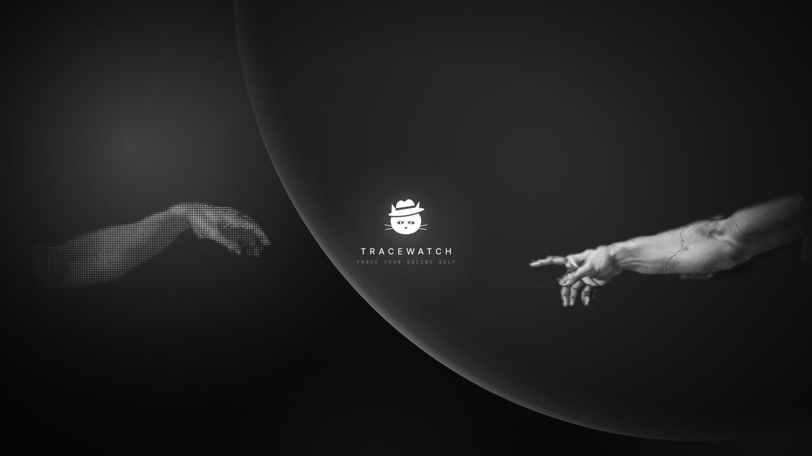

# TraceWatch



A self-hosted, zero-persistence OSINT console: see which breaches, infostealer logs and websites expose an email
address or username, check passwords safely, and inspect phone numbers and Discord accounts. It runs on your own
machine, needs no account, sets no cookies, and forgets everything when you leave the page.

## Quick start

You need [Node.js 20+](https://nodejs.org) and, for updates, [git](https://git-scm.com).

```bash
git clone https://github.com/jtsdnsc7nk-boop/TRACEWATCH.git
```

Then, in the `TRACEWATCH` folder:

| System | Start | Update to the latest version |
| --- | --- | --- |
| Windows | double-click `start.bat` (or run it in a terminal) | `start.bat update` |
| macOS / Linux | `./start.sh` | `./start.sh update` |
| Any, with npm | `npm run setup` | `npm run update` |

The first run installs dependencies and builds the app (a minute or two), then opens
[http://localhost:3000](http://localhost:3000) in your browser. Later runs start in seconds and only rebuild after
an update. Options: `--port 4000`, `--host 0.0.0.0` (expose on your network; the default is this machine only),
`--rebuild`, `--no-open`.

No Node.js on Windows? `winget install OpenJS.NodeJS.LTS`. On macOS: `brew install node`.

### Docker

```bash
docker compose up -d          # start: http://localhost:3000
git pull && docker compose up -d --build   # update
```

The container runs as a non-root user and is published on `127.0.0.1` only; edit `compose.yaml` to expose it.

### Optional keys

Copy `.env.example` to `.env.local` (the start scripts do this for you). Every key is optional:

- `HIBP_API_KEY` adds Have I Been Pwned account search.
- `DISCORD_BOT_TOKEN` makes Discord lookups go straight to Discord.
- `TRACEWATCH_UPDATE_CHECK=off` disables the update check.

## Updates

When a newer version is published on GitHub, a notice with the TraceWatch cat appears in the corner of the app:
**NEW UPDATE pull from GitHub!** with the exact update command for your setup. After you update and restart, a
**What's changed** dialog lists every release since the version you last saw.

The server checks `changelog.json` on the repository's `main` branch at most every 30 minutes. That request
contains nothing you searched; it does tell GitHub your server's IP address. Turn it off with
`TRACEWATCH_UPDATE_CHECK=off`.

### Publishing a release (maintainers)

1. Add an entry at the **top** of `changelog.json` (`version`, `date`, `title`, `changes`).
2. Set the same `version` in `package.json`.
3. Commit and push to `main`. Every running instance shows the update notice within 30 minutes.

## Scanners

| Tab | What it does | Source |
| --- | --- | --- |
| Email | Breaches, pastes and infostealer infections for an address, merged and de-duplicated across sources, with an exposure score | XposedOrNot, LeakCheck (public), Hudson Rock Cavalier (keyless); Have I Been Pwned when `HIBP_API_KEY` is set; thin records enriched from the HIBP catalogue |
| Username | Which of 42 sites (social, developer, gaming, creative, community) have a public profile with a username; each detector is verified against known-real and known-missing names, and blocked or ambiguous answers are reported as unknown, never as found | Direct public profile checks |
| Password | Checks a password against breach corpora using k-anonymity; only a 5-character SHA-1 prefix leaves the browser | Pwned Passwords |
| Phone | Validity, region, line type and formats | libphonenumber (offline) |
| Discord | Account age, username, display name, avatar, banner, badges, server tag and avatar decoration | Discord API when `DISCORD_BOT_TOKEN` is set, otherwise the public japi.rest mirror |
| Breach feed | Searchable, sortable catalogue of every known breach | Have I Been Pwned (keyless) |

## Dashboard

`/dashboard` needs no login. It shows catalogue KPIs, breaches added per month and by incident year, the most exposed
data types, the largest and most recent breaches, live health of every upstream source, and the scans run in the
current tab. Session activity lives in React state only, shows masked targets, and is gone on reload.

## Development

```bash
npm install
npm run dev
```

## Persistence model

Leave the page and nothing remains. Verified against a production build (`next build && next start`):

- **No cookies.** No response sets one. (`next dev` sets its own `__next_hmr_refresh_hash__` cookie for hot reload; production does not.)
- **No browser storage.** No localStorage, sessionStorage, IndexedDB, Cache Storage or service worker.
- **No browser caching of results.** Pages and every API response are sent `Cache-Control: no-store`. Discord avatars and banners
  are streamed through `/api/discord/media` with `no-store`, so the image cache never records which profiles were viewed.
- **No back/forward restore.** If the browser restores a page from its back/forward cache, it reloads empty.
- **No form history.** Every input has `autocomplete="off"`, and searched values never appear in the URL.
- **No server logs or storage.** Queried values are not logged. The only server memory is a per-client rate-limit
  counter and a one-hour cache of the public breach catalogue.
- **Session activity** on the dashboard is React state only (masked targets) and is gone on reload.
- **One file on disk:** `.tracewatch/state.json` holds the last release-notes version the operator dismissed
  (for example `{"acknowledgedVersion": "0.3.0"}`). It never contains search data.

What TraceWatch cannot control: to check a value, it has to send it to the relevant upstream source (XposedOrNot,
LeakCheck, Hudson Rock, Have I Been Pwned, japi.rest, Discord, or the 42 profile sites for a username search). Only a 5-character hash prefix is sent for passwords.
Those services run under their own privacy policies.

Only look up accounts you own or are authorised to assess.

## Wallpapers

Free 4K (3840×2160) desktop wallpapers made from the TraceWatch background:

| Preview | Download |
| --- | --- |
| Cat logo between the hands | [tracewatch-4k-logo.png](wallpapers/tracewatch-4k-logo.png) |
| Hands only | [tracewatch-4k-hands.png](wallpapers/tracewatch-4k-hands.png) |
| Clean background | [tracewatch-4k-clean.png](wallpapers/tracewatch-4k-clean.png) |

## Credits

The hands in `public/hands/` and `wallpapers/` are adapted from Michelangelo's *The Creation of Adam* (public
domain, via Wikimedia Commons).

## License

TraceWatch is free software under the [GNU Affero General Public License v3.0](LICENSE). You can use, study, change
and share it. If you run a modified version for other people, including as a website, you must offer them its
source code under the same license.
